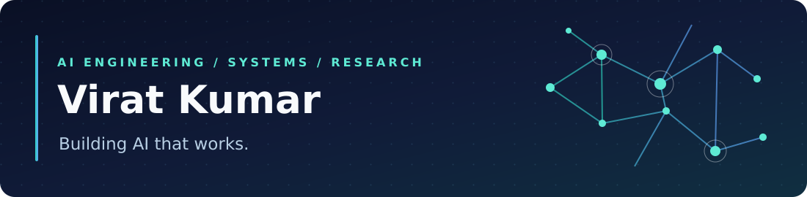
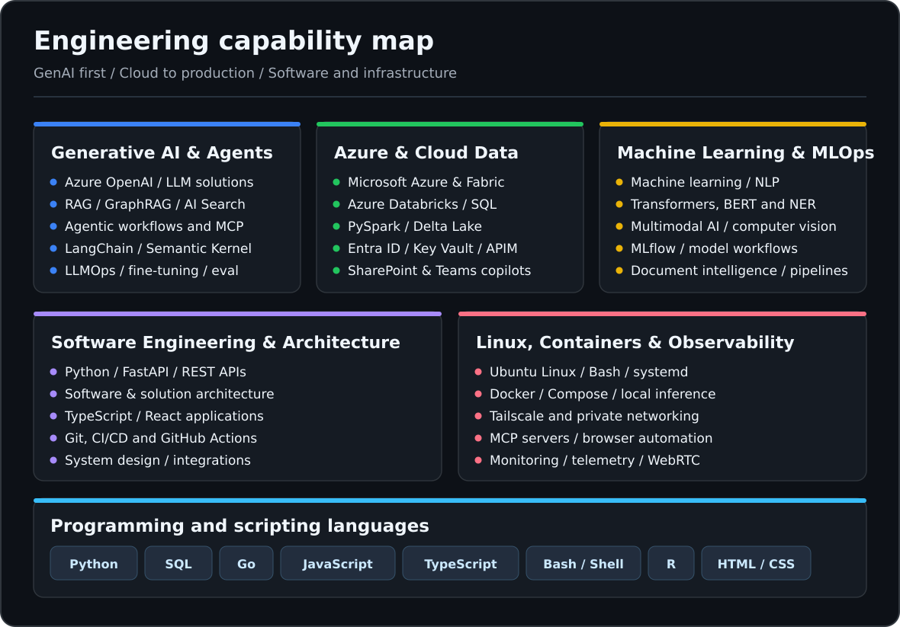

  
  <h2>Generative AI Engineer · LLM Agents &amp; RAG · Azure AI &amp; Databricks</h2>
  
<strong>Building GenAI products end-to-end, from models and data to software architecture, Linux and Docker infrastructure.</strong>

  

    
    
    
    
  

  

### About me

I am a **Generative AI and applied machine-learning engineer** with experience designing and delivering enterprise AI solutions, and a strong interest in the **software and infrastructure behind dependable agents**. My work spans retrieval-augmented generation (RAG and GraphRAG), multimodal AI, tool-using workflows, Azure AI applications, data platforms, APIs, system design, local AI and developer tooling.

I previously worked as a **Senior GenAI Engineer** and **Associate in Data Science** at Celebal Technologies (2020–2025). I completed a **Platinion IT Architect internship at Boston Consulting Group (Jun–Aug 2026)**. That internship concluded in August 2026. I am pursuing an **M.S. in Business Analytics & Artificial Intelligence** at the University of Texas at Dallas; I also hold a **B.Tech in Computer & Communication Engineering** from Manipal University Jaipur.

### GenAI systems I've built

| Applied problem | Technical approach | Outcome from my professional resume |
|---|---|---|
| **Enterprise knowledge assistant** | Azure OpenAI, Azure AI Search, SharePoint ingestion, role-based access controls and retrieval | 93% proof-of-concept accuracy across an initial seven-vessel scope, later expanded to 70 |
| **Agentic proposal automation** | Azure OpenAI, Azure AI Search, SharePoint, Power Apps, confidence scoring and human-in-the-loop workflow | Automated approximately 82% of proposal responses |
| **Analytics copilot** | Microsoft Teams integration, natural-language-to-Databricks SQL, automated charts and root-cause analysis | Reduced routine stakeholder turnaround from roughly a day to minutes |
| **Contact-center AI** | Live agent assistance, Azure, Databricks analytics and automated quality monitoring | Scaled QA analysis across 18–20 contact-center KPIs |
| **Document intelligence** | BERT-based Q&A, named-entity recognition, relation extraction and Azure Databricks | Extracted structured planning data from unstructured documents |

### Technologies and engineering focus

| Area | Technologies and practices |
|---|---|
| **Generative AI / LLMs** | Azure OpenAI, Azure AI Search, RAG and GraphRAG, text-to-SQL, prompt engineering, LangChain, Semantic Kernel, agentic workflows, tool calling, MCP, LLM fine-tuning and LLMOps, application evaluation and human-in-the-loop systems |
| **Cloud and enterprise AI** | Microsoft Azure, Microsoft Fabric, Azure Databricks, Microsoft Teams and SharePoint integrations, Power Apps, Entra ID, Key Vault, Azure VNets and API Management |
| **Data engineering / MLOps** | SQL, PySpark, Delta Lake, Databricks SQL, MLflow, analytical pipelines, data modeling, model experimentation, predictive and prescriptive analytics, machine learning, multimodal AI, computer vision, NLP, Transformers and BERT |
| **Software engineering** | Python, Go, JavaScript, TypeScript, FastAPI, REST APIs, React, modular backend design, system design, software architecture, integrations, CI/CD and GitHub Actions |
| **Linux, Docker and developer infrastructure** | Ubuntu/Linux, Bash/Shell, systemd, Docker, Docker Compose, Git, Tailscale, monitoring and telemetry, Grafana, Prometheus, Playwright/browser automation, PTYs, WebRTC and local inference |
| **Programming, query and web languages** | **Python · SQL · Go · JavaScript · TypeScript · Bash/Shell · R · HTML/CSS** |

Skills above combine verified professional experience, public repository languages and projects, and the additional technologies I have personally confirmed, including Microsoft Fabric. They are not claims of equal proficiency in every technology.

### Latest public work

<!-- LATEST_PUBLIC_START -->
| Latest public repositories | Last updated (UTC) | What it contains |
|---|---|---|
| [college-majors-2026-earnings-debt-ml](https://github.com/virat-kumar/college-majors-2026-earnings-debt-ml) | 2026-10-24 | Reproducible college-major earnings prediction, student debt risk and AI/job outlook analysis (BUAN 6341 Group 2) |
| [usa-real-estate-r-analysis](https://github.com/virat-kumar/usa-real-estate-r-analysis) | 2026-10-22 | Reproducible R analysis of U.S. property listings with official Kaggle download, renv, and Windows/Linux setup |
| [mcp-observability-dashboard](https://github.com/virat-kumar/mcp-observability-dashboard) | 2026-10-19 | Unified analytics, health, and safe telemetry dashboard for OpenAI-connected MCP servers, with zero MCP code change |
<!-- LATEST_PUBLIC_END -->

This section refreshes from public GitHub repositories through a daily GitHub Action. Private projects are excluded, and forks are identified.

### Selected open-source and applied projects

| Project | What I built or maintain | Focus |
|---|---|---|
| **[Terminal MCP](https://github.com/virat-kumar/terminal-mcp)** | My working fork of a persistent interactive terminal MCP with real PTYs, live observation and human takeover | Go, MCP, agent tooling |
| **[MCP Observatory](https://github.com/virat-kumar/mcp-observability-dashboard)** | Request-level inspection, operational dashboards and MCP telemetry without instrumenting every server | Python, Grafana, Prometheus |
| **[Syllabus Gap Analyzer](https://github.com/virat-kumar/course-gap-analyzer)** | AI-powered course-syllabus vs. job-market skill gap analysis | LangChain, FastAPI, Streamlit |
| **[Toyota Finance Agent](https://github.com/virat-kumar/agenttoyota)** | Conversational automotive-finance prototype, including loan and lease calculations | TypeScript, React, Python |
| **[Dallas Student Navigator](https://github.com/virat-kumar/aws-agentic-ai-hackathon)** | AI assistant prototype to help international students with housing, transport and daily life | Python, AWS AI |
| **[UrbanEase Database](https://github.com/virat-kumar/UrbanEase-database)** | E-commerce database design spanning customer accounts, inventory, orders and payments | SQL, MySQL |

### Certifications, education and research

- **Certifications:** Databricks Certified Generative AI Engineer Associate · Microsoft Certified Azure Data Scientist Associate · Microsoft Certified Azure Data Fundamentals
- **Education:** M.S. Business Analytics & Artificial Intelligence, UT Dallas (in progress) · B.Tech Computer & Communication Engineering, Manipal University Jaipur
- **Earlier research:** “Conversion of two dimensional images into multi-view images of bone using deep learning” (2020)
- **Recognition:** Second-place Green-a-thon project focused on computer-vision-based automatic waste segregation (2018)

### How I approach engineering

~~~mermaid
flowchart LR
    A["Understand the problem"] --> B["Design the system"]
    B --> C["Build AI + data + APIs"]
    C --> D["Deploy and observe"]
    D --> E["Evaluate and improve"]
    E --> B
~~~

  <strong>From enterprise GenAI to the infrastructure that makes AI reliable.</strong>
  
Explore the projects above, review the source code, or connect on <a href="https://www.linkedin.com/in/kumar-virat/">LinkedIn</a>.

